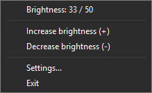
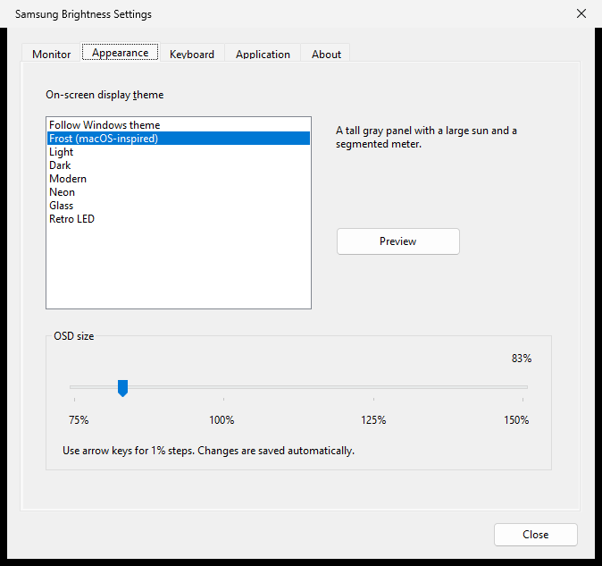
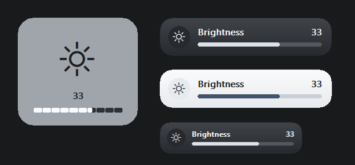
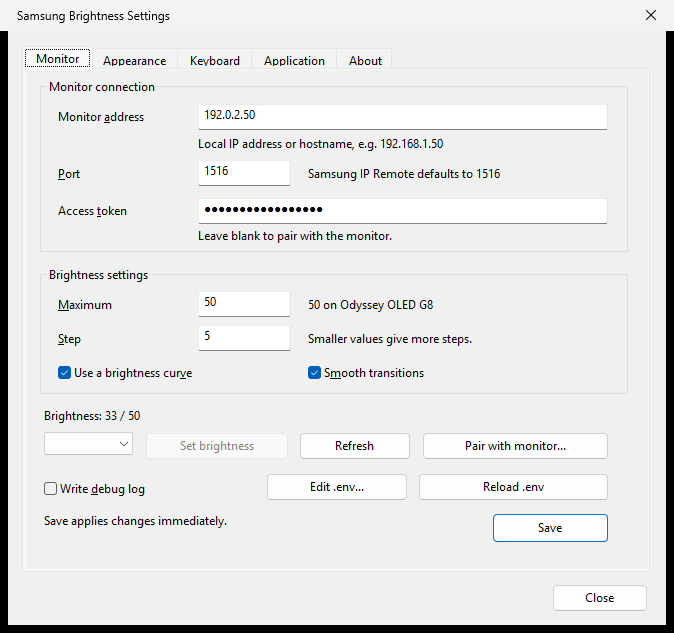

<p align="center"></p>

# Samsung Brightness

A tiny Windows tray app that controls the **hardware brightness** of Samsung Tizen-based monitors
(such as the Odyssey OLED G8) **over the local network**. Use your keyboard's brightness keys or
set your own shortcuts, with a customizable on-screen indicator.

> [!NOTE]
> **This project is fully AI-generated.** All code, documentation and commits in this repository
> were written by an AI assistant (Claude by Anthropic) under the direction of the repository owner.
> It was tested on real hardware, but review it as you would any third-party code.

## Why

Some Samsung smart/gaming monitors, such as the Odyssey OLED G8 (G85SB), **do not support DDC/CI**.
Tools such as Twinkle Tray, Monitorian or PowerToys cannot change their brightness, and Windows has
no brightness slider for external monitors anyway.

These monitors run Tizen and include the **Samsung IP Control** server: a JSON-RPC API over HTTPS
in your local network. Its `backlightControl` method reads and changes the real panel brightness.
This app wraps that API in a lightweight tray utility.

The monitor does **not** need internet access; LAN access is enough.

## Features

- **Brightness keys**: works with the standard HID *Brightness Up / Down* keys of any keyboard.
  Holding a key repeats it.
- **Global shortcuts** let you assign your own keys for increasing and decreasing brightness.
- **Gentle dimming**: brightness fades smoothly to the new level instead of jumping. The steps follow
  a curve: small in the dark range, where the eye notices changes most, larger near the maximum
  (`0, 1, 2, 5, 8, 13, 18, 25, 32, 41, 50` by default). Both can be turned off in the settings.
- **On-screen display** shows each brightness change. Choose from eight themes and adjust the size in Settings.
- **Tray icon** shows the current brightness in its tooltip. Left-click shows the indicator.
  Right-click to show the current brightness, increase or decrease it, open Settings, or quit.
- **Startup check** reads the monitor's brightness in the background. If an already paired monitor
  is unavailable, the app shows the error on screen and on the **Monitor** tab in Settings.
- **Command line**: `SamsungBrightness.exe up`, `down`, `set 25`, `show`, `exit`.
  Bind these to any key or macro tool.
- **Start with Windows** is available in **Settings → Application**.
- **Light on resources**: a single native exe (C++ / Win32, no frameworks or runtimes).
  It uses about 4 MB of RAM and no CPU while idle (see [Resource usage](#resource-usage)).
- **Responsive**: keeps the HTTPS connection alive, merges fast key presses, never blocks the UI.

## Tested with

| Monitor | Model code | Firmware |
|---|---|---|
| Samsung Odyssey OLED G8 (G85SB), 34" | LS34BG850SUXEN | 1720 |

| Keyboard | Connection | Result |
|---|---|---|
| Logitech MX Keys S, Logi Options+ running | Bolt receiver | Works (HID++ diverted keys) |

Other Tizen-based Samsung monitors with "IP Remote" will probably work too. The brightness range
may differ; set `BRIGHTNESS_MAX` accordingly. Reports are welcome.

## Setup

1. **On the monitor**: connect it to your network and enable **IP Remote** in its settings.
2. **In your router** *(recommended)*: reserve a fixed IP address for the monitor (DHCP reservation),
   so the address does not change.
3. **Install**: download the latest version from [Releases](../../releases):
   - `SamsungBrightness-x.y.z-setup.exe`: an installer for the current user (no administrator rights).
     It can turn on "Start with Windows", adds a Start menu shortcut and has an uninstaller.
   - `SamsungBrightness-x.y.z-portable.zip`: just the exe. Put it into any folder and start it.

   The files are not code-signed, so Windows SmartScreen may warn on the first start.
   Choose **More info → Run anyway**.
4. **First start**: enter the monitor's local IP address or hostname in the **Settings** window.
   Click **Save** to write the local `.env` and apply the settings immediately.
5. **Pairing**: when the app asks, choose **Yes**, or use **Monitor → Pair with monitor...** in Settings.
   Accept the request **on the monitor screen**. The access token is saved to `.env` automatically.
6. **Autostart**: check **Application → Start with Windows** in Settings.

## Tray menu and appearance

Right-click the tray icon for current brightness, **Increase**, **Decrease**, **Settings...**, and
**Exit**. Select the brightness line to show it on screen.



Settings has five tabs. **Monitor** includes brightness presets, refresh, pairing, and `.env` tools.
**Appearance** keeps the theme list and size slider visible while you try different looks.
**About** shows the version and opens GitHub, Buy Me a Coffee, or Ko-fi in your browser.



Select a theme in **Appearance** to apply it and see the indicator. Click **Preview** to see it again.

| Theme | Appearance |
|---|---|
| Follow Windows theme | Windows-style indicator that follows the system's light or dark mode |
| Frost | Tall, muted gray panel with a large sun and a thin segmented meter |
| Light | Warm ivory panel with an amber meter |
| Dark | Charcoal panel with a muted violet meter |
| Modern | Navy pill with a wide blue meter |
| Neon | Dark panel with a high-contrast green meter |
| Glass | Translucent card with a soft neutral gradient and light and dark variants that follow Windows |
| Retro LED | Amber segmented meter and monospace numbers |



The **Appearance** tab has a live slider from **75%** to **150%**. Dragging snaps near 75%, 100%, 125%
and 150%. Use the arrow keys to move by 1% and set values such as 83%. The size applies to the whole
indicator at the display's current DPI. Themes and sizes are saved automatically. Previews leave the
monitor's brightness alone. Actual brightness changes
immediately take over the indicator.

## Keyboard

Open the **Keyboard** tab in Settings and click **Record...** next to the action you want to change.
With the recording field focused, press the keys together, release them, and click
**Save**. You can use one key or hold up to five keys, including several ordinary keys. **Clear**
followed by **Save** removes the assignment. Shortcuts work while other apps have focus. Windows
registers shortcuts with one ordinary key and optional modifiers system-wide. For chords with
several ordinary keys, the foreground app still receives the keystrokes. Your assignments are saved
for your Windows account.

The dedicated brightness keys stay enabled by default. Uncheck **Use keyboard brightness keys** in
the same tab to use only your custom shortcuts from the keyboard.

The app reads dedicated brightness keys with Windows Raw Input and registers custom shortcuts with
Windows. It installs no keyboard hooks and needs no special rights. Dedicated keys work in two ways:

1. **Standard HID keys** (*Consumer* page `0x0C`, usages `0x6F` Brightness Increment and
   `0x70` Brightness Decrement). Most keyboards send these.
2. **Logitech keyboards with Logi Options+** (tested: MX Keys S on a Bolt receiver). Options+
   *diverts* the special keys: the keyboard then sends Logitech HID++ notifications
   (feature `REPROG_CONTROLS_V4`, control IDs `0x00C7` Brightness Down and `0x00C8` Brightness Up)
   instead of standard codes. The app asks each Logitech keyboard once where this feature is and
   then listens for those notifications. Receivers (Bolt, Unifying) and Bluetooth are supported.

What to do:

- **Most keyboards**: nothing to configure. Press the brightness keys.
- **Logitech keyboards with Logi Options+**: keep the brightness keys on their default action
  (*Brightness up / down*). If a key gets a custom action, the app does not see it.
- **Keyboard and macro tools** can also run
  `SamsungBrightness.exe up` and `SamsungBrightness.exe down`. Each call passes the command to the
  running instance and exits within milliseconds.

To check what your keyboard sends, set `DEBUG_LOG=1` and look at `samsung-brightness.log`
after pressing a key.

## Settings (`.env`)

Open **Settings...** from the tray to edit the monitor address, port, access token, brightness
settings, and debug logging. The form explains each setting and validates number ranges. **Save**
writes the local `.env` and applies the changes to the running app. The access token is masked in
the form. The file stays next to the executable and is ignored by Git.



| Key | Default | Description |
|---|---|---|
| `SAMSUNG_MONITOR_IP` | — | IP address of the monitor |
| `SAMSUNG_ACCESS_TOKEN` | — | Filled in by pairing |
| `SAMSUNG_MONITOR_PORT` | `1516` | Port of the IP Control server |
| `BRIGHTNESS_STEP` | `5` | Change per key press. With `NONLINEAR_STEPS=1` it sets the number of steps instead (`BRIGHTNESS_MAX / BRIGHTNESS_STEP`) |
| `BRIGHTNESS_MAX` | `50` | Highest brightness the monitor accepts (50 on the Odyssey OLED G8) |
| `NONLINEAR_STEPS` | `1` | `1`: steps follow a curve (small at low brightness). `0`: equal steps of `BRIGHTNESS_STEP` |
| `SMOOTH_TRANSITIONS` | `1` | `1`: fade to the new level in a few small requests. `0`: change at once |
| `DEBUG_LOG` | `0` | `1` writes `samsung-brightness.log` next to the exe |

See [`.env.example`](.env.example). To edit the text file directly, open **Monitor → Edit .env...** and
choose **Monitor → Reload .env** after saving.

## Command line

```text
SamsungBrightness.exe            start in the tray (or show the level if already running)
SamsungBrightness.exe up         increase brightness by one step
SamsungBrightness.exe down       decrease brightness by one step
SamsungBrightness.exe set 25     set brightness to 25
SamsungBrightness.exe show       show the current brightness
SamsungBrightness.exe exit       close the running instance
```

## How it works

```text
Keyboard brightness key ──(HID 0x0C/0x6F, 0x70)──► Raw Input ─┐
Logitech + Options+ ──(HID++ CID 0x00C7, 0x00C8)──► Raw Input ─┤
SamsungBrightness.exe up/down ──(WM_COPYDATA)─────────────────┤
Tray menu ────────────────────────────────────────────────────┤
                                                               ▼
                                           BrightnessController (UI thread)
                                           shows the OSD, decides what to send
                                                               │
                                                               ▼
                                           BrightnessWorker (background thread)
                                           merges requests, keeps the connection alive
                                                               │  HTTPS, JSON-RPC, LAN
                                                               ▼
                                           Monitor: backlightControl (0–50)
```

Protocol example (`POST https://<monitor-ip>:1516/`, headers `Content-Type` and `Accept: application/json`):

```json
{"jsonrpc":"2.0","id":"1","method":"backlightControl","params":{"AccessToken":"<token>","backlight":25}}
```

Without `"backlight"` the method only reads the current value. `createAccessToken` (no params) starts pairing.

## Resource usage

Measured on Windows 11 (x64) after 5 minutes of use, including key presses and tray menu use:

| Metric | Value |
|---|---|
| RAM, as shown in Task Manager (private working set) | **3.8 MB** |
| Committed memory (private bytes) | 4.5 MB |
| CPU while idle (measured over 60 s) | **0 ms** |
| CPU in total for 5 minutes of use | 0.34 s |
| Threads | 7 (2 own, the rest are Windows networking thread pool) |
| Executable size | 835 KB, no dependencies |

While idle, the app does no polling and has no timers. It sleeps until a key press, a tray click or
a command arrives. Most of the remaining memory belongs to Windows components every tray app with
HTTPS needs (the notification area API, WinHTTP and the TLS stack). The app's own data is a few
kilobytes.

## Security notes

- The monitor uses a **self-signed TLS certificate**, so the app **does not verify the certificate**.
  The traffic is encrypted but not authenticated. Use it only in a trusted home network.
- The access token is stored as plain text in `.env` next to the exe. Anyone who can read the file
  can control the monitor's IP Remote functions. Do not share or commit it (`.gitignore` excludes it).
- To revoke access, disable IP Remote or reset the network settings on the monitor.

## Limitations

- Windows itself still does not know the monitor's brightness: there is no slider in Quick Settings.
  Windows offers no supported way to add one for an external monitor without the graphics driver's help.
- The on-screen display appears on the **primary** monitor. It cannot be shown over games running in
  exclusive fullscreen mode (borderless windowed works).

## Building from source

Requirements: Windows 10/11 x64, Visual Studio 2022 or newer with the **Desktop development with C++**
workload, which includes CMake and Ninja.

```bat
build.cmd
```

The result is `build\SamsungBrightness.exe`. The C++ runtime is linked statically, so the exe
needs no redistributable. Pass a version to embed it in the exe properties: `build.cmd 1.2.0`.

### Continuous integration and releases

[GitHub Actions](.github/workflows/build.yml) builds the exe, the installer ([Inno Setup](https://jrsoftware.org/isinfo.php),
script in `installer/`) and the portable zip for every push and pull request. The files are attached to the
workflow run as artifacts.

To publish a release, push a version tag:

```bat
git tag v1.2.0
git push origin v1.2.0
```

The workflow then builds version 1.2.0 and creates a GitHub Release with the installer and the zip.

Project layout:

| File | Responsibility |
|---|---|
| `src/main.cpp` | Entry point, single instance, forwarding commands to the running instance |
| `src/app.cpp`, `src/app_menu.cpp` | Hidden main window: message handling, keys, tray menu, settings, pairing |
| `src/brightness_controller.*` | Brightness logic on the UI thread (optimistic updates, OSD) |
| `src/brightness_worker.*` | Background thread for network calls, request merging |
| `src/brightness_transition.cpp` | Smooth transitions (part of the worker) |
| `src/brightness_scale.*` | Linear or curved brightness steps, tray presets |
| `src/samsung_client.*` | Samsung IP Control client (WinHTTP) |
| `src/json_rpc.*` | Minimal JSON-RPC helpers |
| `src/consumer_key_listener.*` | Standard HID brightness keys (Raw Input) |
| `src/logitech_key_listener.*` | Logitech HID++ brightness keys diverted by Logi Options+ |
| `src/shortcuts.*`, `src/shortcut_dialog.cpp` | Global shortcuts, registration and setup dialog |
| `src/osd_window.*` | On-screen display |
| `src/osd_theme.*` | OSD theme choices and per-user preferences |
| `src/tray_icon.*`, `src/tray_menu.*` | Notification area icon and menu |
| `src/config.*`, `src/paths.*` | `.env` settings |
| `src/settings_dialog.cpp`, `src/settings_pages.cpp` | Settings tabs, controls and input validation |
| `src/autostart.*` | "Start with Windows" |
| `src/pairing.*` | Getting an access token from the monitor |
| `installer/SamsungBrightness.iss` | Inno Setup installer script |
| `.github/workflows/build.yml` | CI build and release publishing |
| `tools/make-icon.ps1` | Regenerates `resources/app.ico` with ImageMagick |

## Credits

The Samsung IP Control API was documented by the community, for example in the
[BetterDisplay discussion](https://github.com/waydabber/BetterDisplay/issues/5861).

## Disclaimer

This is an unofficial project and is not affiliated with or endorsed by Samsung.
"Samsung" and "Odyssey" are trademarks of their respective owners.

## License

[MIT](LICENSE)
